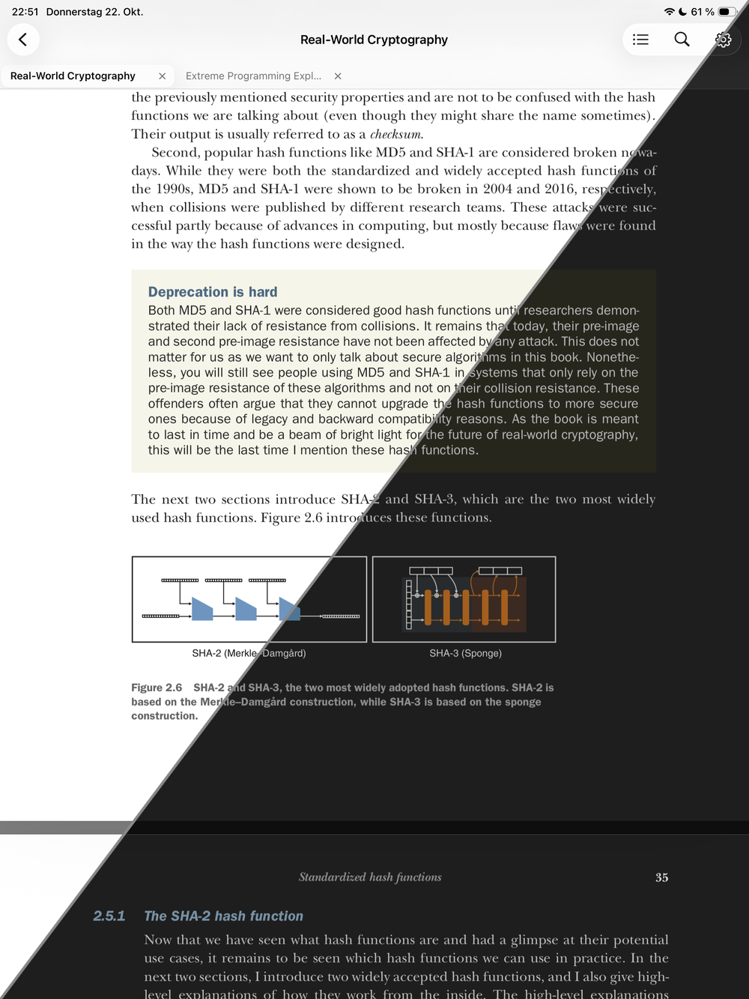

# Leaf

[](https://github.com/tim-hilt/leaf/actions/workflows/build.yml)
[](https://github.com/tim-hilt/leaf/actions/workflows/test.yml)

<p align="center">
  
</p>

## Setup

Requires macOS on Apple silicon.

1. Install [Xcode](https://developer.apple.com/xcode/) and select it:
   `sudo xcode-select -s /Applications/Xcode.app`
2. Install [rustup](https://rustup.rs). The toolchain and Apple targets in `rust-toolchain.toml` are installed on first use.
3. Install XcodeGen: `brew install xcodegen`
4. Enable the pre-commit hook (runs `make lint`): `git config core.hooksPath .githooks`

## Core

```sh
make test   # run tests
make lint   # rustfmt, clippy, swift format
make fmt    # fix formatting (Rust and Swift)
```

## Apple clients (iOS, iPadOS, macOS)

```sh
make apple                    # build core into apple/LeafCore, generate the Xcode project
open apple/Leaf.xcodeproj  # run the Leaf scheme on a simulator or "My Mac"
```

- After changing Rust code: `make apple-core`
- After adding/removing Swift files or editing `apple/project.yml`: `make apple-project`
- Build for macOS and the iOS Simulator: `make apple-build` (regenerates the project first)
- Tests, including both builds: `make apple-test` (macOS)
- Tests on an iOS Simulator, for iOS-only code: `make apple-test-ios` (`SIM=<device name>`)
- Narrow either to a suite or test: `ONLY=LeafTests/ReaderPDFViewTests`. Full log: `/tmp/leaf-test.log`
- Debug build of the core: `make apple-core PROFILE=dev`
- OAuth clients for Google Drive and OneDrive (maintainer, one-off, re-runnable): `scripts/cloud-oauth-wizard.sh`
- Running on a device: create `apple/Config/Local.xcconfig` with `DEVELOPMENT_TEAM = <your team ID>`

### Install on an iPad without opening Xcode

One-time: enable Developer Mode on the iPad (Settings → Privacy & Security). Connect it by cable and tap Trust. For Wi-Fi installs, tick Xcode → Window → Devices and Simulators → your iPad → **Connect via network** (same Wi-Fi as the Mac).

```sh
make apple
cd apple && xcodebuild -scheme Leaf -configuration Release -destination 'generic/platform=iOS' \
  -derivedDataPath build -allowProvisioningUpdates build
xcrun devicectl list devices   # find the iPad
xcrun devicectl device install app --device "<iPad name>" build/Build/Products/Release-iphoneos/Leaf.app
```

Free Apple ID builds expire after 7 days; install again to renew.
